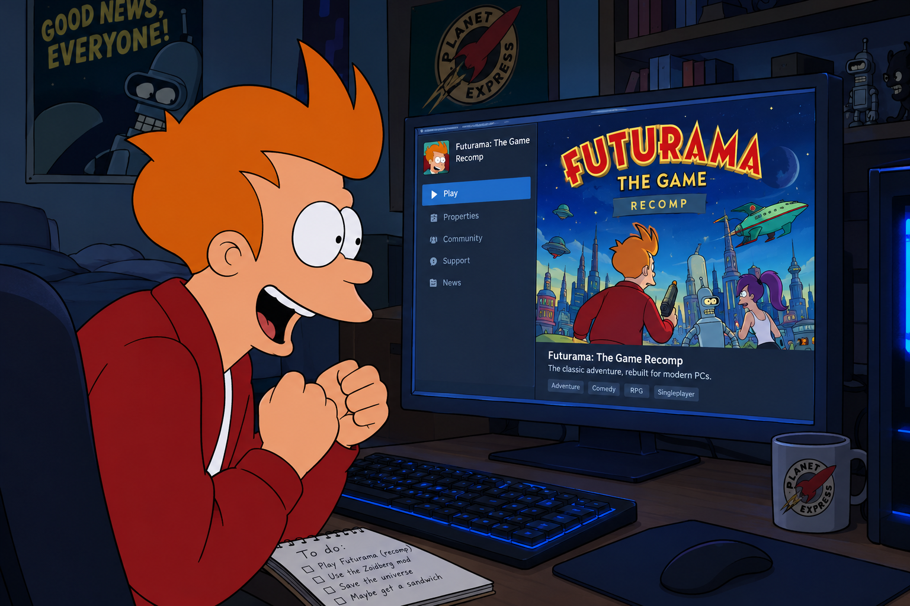

# Futurama: The Game: The Recomp

**Good news, everyone!** The 2003 Futurama game for the original Xbox now runs natively on Windows and Linux!

I rebuilt the whole game in C++, one function at a time, straight from the original Xbox code.
Graphics go through Direct3D 11 (translated to Vulkan on Linux). Window management, audio and input are handled via
SDL3, so you can bring your keyboard or Xbox / DualShock / Switch controller.

The aim was 1:1 with the original. Same levels, same physics, same scripts, same timing, even the same random
numbers, frame for frame. It's not a remake or a remaster. It's the same game, it just runs outside of the PS2/Xbox now.
Automated full playthroughs, replayed on this port and on the original via emulator, confirm it is frame-perfect
start to finish: all 752,000 frames of a complete playthrough match.

It's not an automatic translation of the disc (a static recomp). All of the game's code is decompiled right here in
this repo, written out in C++, and it's what gets compiled into the exe. Nothing from the disc's executable gets
translated or run as game code.

### You'll need your own copy

There's no game data in here. You need your own Xbox copy of Futurama, either the North American (NTSC-U) or the
European (PAL) one, as a disc image (`.iso`) or the extracted files. All the models, textures, sounds, movies and
scripts get loaded from that when you play.

## Playing

Grab the build for your system from the [Releases](../../releases) page.

**Windows.** Unzip it anywhere and double-click `FuturamaRecomp.exe`. The first time, it asks for your disc image
(your `.iso`, or the `default.xbe` of an extracted disc) and remembers it from then on. Windows 10 or 11, 64-bit,
nothing else to install.

**Linux.** Unpack the tarball and run `./FuturamaRecomp <your futurama.iso>`. A Vulkan driver is all it needs.

It starts full screen at your screen's resolution, 4:3 with black bars; Alt+Enter toggles windowed mode. Options:

| Option | Effect |
| --- | --- |
| `--windowed` | start in a window (1280x960) |
| `--size 1920x1080` | the window size |
| `--render-scale 1` | the original 640x480 picture scaled up (`2` = 1280x960, default `auto` = your screen) |
| `--filter nearest` | crisp unfiltered pixels instead of smooth scaling |
| `--aa 4` | scene anti-aliasing with 1, 2, 4 or 8 samples, plus alpha-to-coverage on alpha-tested world geometry (default `1` = off) |
| `--anisotropic 16` | anisotropic filtering for trilinearly sampled world textures with authored mip chains (`off`, `2`, `4`, `8` or `16`; default `off`) |
| `--aspect 16:9` | widescreen, up to super-ultrawide (`16:10`, `21:9`, `32:9`, any `w:h`, or `auto` = your screen's shape): more world at the sides, the HUD at the edges, movies and splashes centred (default `4:3`; see below) |
| `--saves <folder>` | where saves go (default `%APPDATA%\FuturamaRecomp\saves`, or `~/.local/share/FuturamaRecomp/saves` on Linux) |

An Xbox controller just works, and so do most other pads (DualShock, DualSense, Switch Pro and the like), plugged in
before or during play. No controller? The keyboard does it too (the physical keys, on any layout):

| Keys | Xbox pad |
| --- | --- |
| W A S D | left stick |
| I J K L | right stick |
| arrow keys | d-pad |
| Space / E / Left Ctrl / R | A / B / X / Y |
| Q / F | White / Black |
| Z / Shift | left / right trigger |
| Enter / Esc | Start / Back |

## Building

**Windows.** You need Visual Studio 2022 with the "Desktop development with C++" workload and CMake 3.25 or newer.

```
cmake -S . -B build -G "Visual Studio 17 2022" -A x64
cmake --build build --config Release
```

**Linux.** You need GCC 13 or Clang 17, CMake 3.25, SDL3's build dependencies (the list in SDL's
README-linux) and [DXVK-native](https://github.com/doitsujin/dxvk/releases) 3.1.1
(`dxvk-native-3.1.1-steamrt-sniper.tar.gz`), extracted somewhere; point `FUT_DXVK_ROOT` at its `usr` folder. SDL3 is
fetched and built by CMake on both platforms.

```
cmake -S . -B build -DCMAKE_BUILD_TYPE=Release -DFUT_DXVK_ROOT=/path/to/dxvk/usr
cmake --build build -j
cmake --install build --prefix dist
```

`dist/FuturamaRecomp` runs with SDL3 and DXVK's two libraries beside it; you need a Vulkan 1.3 driver.

Have fun!

## Quality-of-life improvements

- **🖥️ Render scaling.** The game's backend renderer faithfully upscales the scene quality dynamically based on the
  resolution of your monitor. This results in a significantly sharper image with fewer artifacts. This default is
  equivalent to `--render-scale auto`; `--render-scale 1` forces the original resolution.
- **📺 Widescreen, ultrawide and super-ultrawide.** `--aspect 16:9` renders a wider picture: the same vertical
  view with more world at the sides, the HUD anchored to the edges instead of stretched, movies and the 4:3 artwork
  centred with black beside them. Any shape from 4:3 to 32:9 works: `16:10` (Steam Deck), `21:9` ultrawide, `32:9`
  super-ultrawide, or any `w:h`; `auto` takes your screen's exact shape, which is the right choice for an ultrawide
  (their real ratio is rarely the nominal 21:9). It's opt-in and stays off by default (4:3): the levels were
  built for a 4:3 view, so you may see their edges, backdrops ending, or characters waiting off-stage. The 4:3
  picture is untouched by it, byte for byte.
- **⚡ 60 Hz for both discs.** The PAL version originally ran at 50 Hz. Regardless of which iso you supply (NTSC or PAL),
  you'll get the improved 60 Hz experience.
- **🌐 Revived the Language Menu from the PAL PS2 disc.** The European Xbox release takes its language from the console's settings. The
  PS2 version has a language menu at start-up, and its graphics are still on the Xbox discs, so I ported it. Pick
  English, French, German, Italian or Spanish and you get that language's text, speech and movies. The NTSC disc
  only has English speech, so it stays English.
- **🐛 A few of the original's bugs fixed.** The aim is 1:1, so any bug that changes what you see or how the game plays
  stays in. The only ones I fixed are where the original's result comes down to luck (memory it never sets up) or
  would crash the Xbox.

<details>
<summary>The original's bugs and what I did with them</summary>

| Bug | Status |
|---|---|
| Dead enemies always fade away one second after dying, so longer death animations get cut off (most weasels) | Left original |
| Spawning one kind of toxic warrior can hand the other kinds its shotgun | Left original |
| Shots at some breakable objects ignore the object's rotation and can't hit one of its six sides | Left original |
| The rat ride's steering is never reset, so riding it a second time starts with the old steering | Left original |
| A script that turns a path point saves the wrong number as its angle | Left original |
| A respawned enemy can skip planning its path and walk straight at you for a moment | Fixed |
| A grenade trooper killed before it ever attacks throws its dying grenade in an unpredictable direction | Fixed |
| A respawned weasel can copy the death animation of the weasel it replaced | Fixed |
| A few enemies (the 2-5 tank, the 5-1 Destructor) start falling one frame late | Fixed |
| Resetting the player can shift the player's model out of place | Fixed |
| The lock-on marker's see-through level is random instead of half | Fixed |
| The high priest (3-6) starts with a random summon timer and warp spot | Fixed |
| A few enemies and the 4-1 rat ride can act on a sound that was never started | Fixed |
| Settings missing from a config file get random values (the game's own files never miss any) | Fixed |
| Objects start with a random count of how many frames since they were last drawn | Fixed |
| Crashes only bad data could cause (missing objects, dividing by zero, broken files, running out of memory) | Fixed |

</details>

## Contributors

- [igno2k](https://github.com/igno2k)
