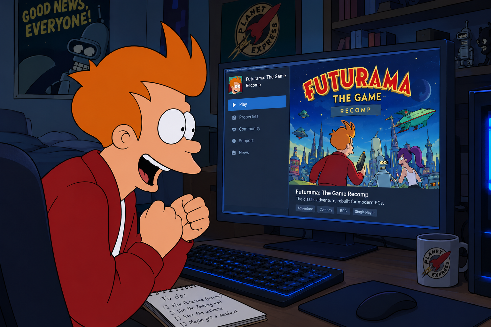

# Futurama: The Game: The Recomp

**Good news, everyone!** The 2003 Futurama game for the original Xbox now runs natively on Windows. No emulator,
just a real Windows build.

I rebuilt the whole game in C++, one function at a time, straight from the original Xbox code (the `// orig:` comments point back to where each bit lives in the original).
Graphics go through Direct3D 11, sound through XAudio2, and you can play with an Xbox controller or the keyboard.

The aim was 1:1 with the original. Same levels, same physics, same scripts, same timing, even the same random
numbers, frame for frame. It's not a remake or a remaster. It's the same game, it just runs on your PC now.

It's not an automatic translation of the disc either. All of the game's code is right here in this repo, written out
in C++, and it's what gets compiled into the exe. Nothing from the disc's executable gets translated or run as game
code. The disc is only read for the stuff that can't be shared: the models, textures, sounds, music, movies, level
scripts, text, and some data tables stored inside the original `default.xbe`. There's one exception: the Xbox's sound
chip has its own little DSP programs (the effects in `dsstdfx.bin` on the disc, plus a small startup program inside
`default.xbe`), and those run on a tiny built-in emulation of that audio DSP, just like they would on the console.

### You'll need your own copy

There's no game data in here. You need your own NTSC-U Xbox copy of Futurama, either as a disc image (`.iso`) or the
extracted files. All the models, textures, sounds, movies and scripts get loaded from that when you play.

## How I made it

This took about two weeks (12-25 October 2026), with Claude Opus 5.5 on high reasoning effort doing most of the heavy
lifting. Every function was rewritten by reading and understanding the original machine code, then tested against
the real thing.

A few things that made it work:

- I used both the Xbox and PS2 versions. The Xbox version is the one I ported and tested against. The PS2 version
  still had its class and function names left in, so it was basically a map of the code.
- The original game runs in an emulator I put together on top of [Unicorn](https://www.unicorn-engine.org/), and the
  port gets compared against it frame by frame: player and camera, enemies, every script call, the random numbers,
  physics, graphics calls, sound and movies. If a single bit is off, the test fails.
- Lots of playtesting. First a bot that finds its own way around each level. Then me playing, with my inputs recorded
  and replayed on the original. And finally a lockstep mode, where the original runs right alongside the port while I
  play and every frame gets checked live.

## How close is it?

Really close. Every game function the tests reach (701 of them) matches the original. That's backed by almost 4,000
object tests, 60 level tests, 38 rendering tests, the menus, sound, movies and full playthroughs. One run goes from
the start of level 1-1 to the end and on into level 1-2, and all 3.7 million things it compares match.

What I can't fully promise yet:

- I haven't compared the final picture and sound with a real Xbox. The port sends exactly the same graphics and sound
  commands, but how they come out on actual hardware hasn't been checked.
- In a few spots the original reads memory it never set up. The port uses fixed values there, so very rarely something
  can happen a frame early (like a respawned enemy moving).
- The emulator I tested against does a few maths instructions (sine, cosine and a couple of others) slightly
  differently from a real Xbox, so those could be off in the very last bit.
- Code that nothing ever reaches, like old debug features, is ported but untested.

## Building

You need Windows, Visual Studio 2022 with the "Desktop development with C++" workload, and CMake 3.25 or newer.

```
cmake -S . -B build -G "Visual Studio 17 2022" -A x64
cmake --build build --config Release
```

## Playing

The easy way: grab the zip from the [Releases](../../releases) page, unzip it anywhere and double-click
`FuturamaRecomp.exe`. The first time, it asks for your disc image (pick your `.iso`, or the `default.xbe` inside your
extracted folder) and remembers it from then on. Put the `.iso` (or a `futurama` folder with the extracted files)
right next to the exe and it finds it by itself. Windows 10 or 11, 64-bit, nothing else to install.

Built it yourself? Double-click works the same, or point it straight at your disc:

```
build\Release\FuturamaRecomp.exe <your futurama.iso or extracted folder>
```

Add `--size 1920x1080` to change the window size (the default is 1280x960). Saves go to
`%APPDATA%\FuturamaRecomp\saves`, or wherever you point `--saves`.

An Xbox controller just works. No controller? The keyboard does it too:

| Keys | Xbox pad |
| --- | --- |
| W A S D | left stick |
| I J K L | right stick |
| arrow keys | d-pad |
| Space / E / Left Ctrl / R | A / B / X / Y |
| Q / F | White / Black |
| Z / Shift | left / right trigger |
| Enter / Esc | Start / Back |

Have fun!

Both native hosts accept `--language German` (also English, French, Italian and Spanish;
case-insensitive). English remains the default. Selection happens before menus and save
labels are loaded. Available text and voice assets depend on the supplied disc.
